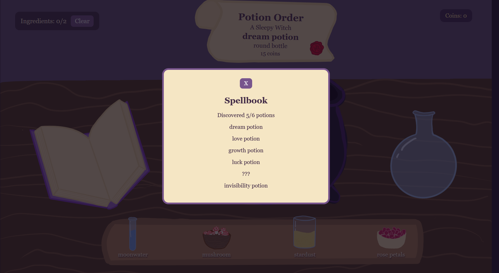
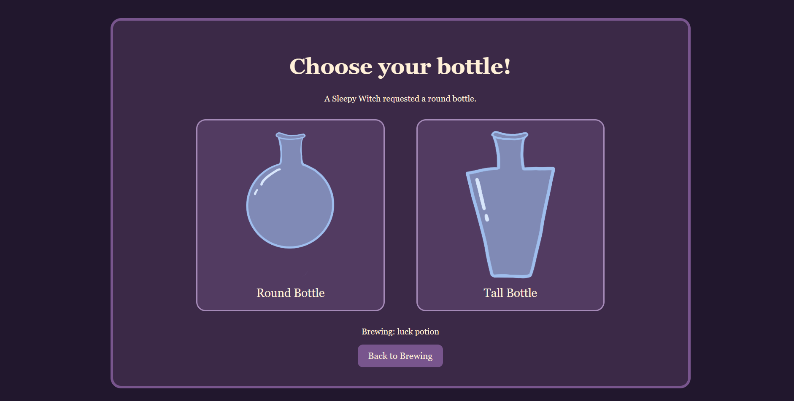
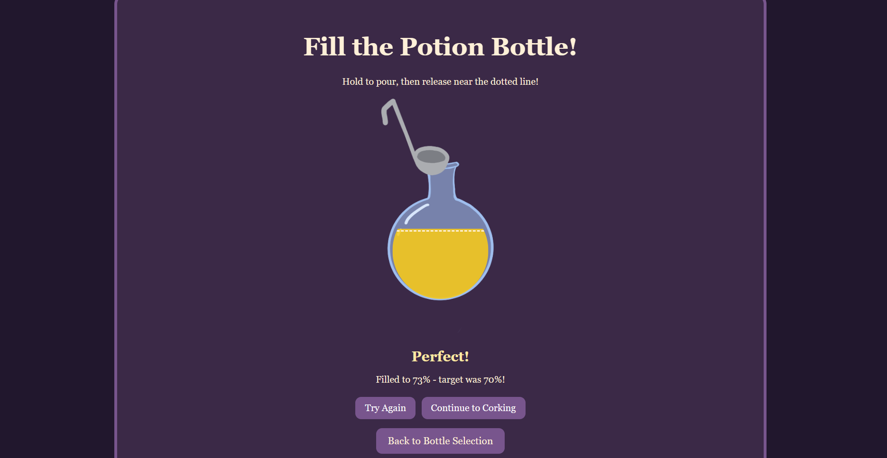
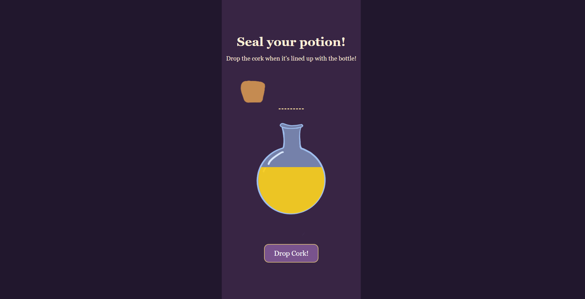

# ✨ Witch's Brew ✨

A cozy little potion-making game where you run your own witchy potion shop, experiment with magical ingredients, and brew potions for customers!

Made for **Hack Club Terra — Week 3: Spooky**.

## How to Play

1. **Read your order!** Check the parchment to see which potion and bottle shape your customer wants.
2. **Brew a potion!** Drag ingredients over the cauldron and scroll to tilt the containers and pour them in.
3. **Discover recipes!** Experiment with different ingredient combinations to unlock new potions in your spellbook.
4. **Choose a bottle!** Pick between a round or tall bottle.
5. **Pour your potion!** Click and hold to fill the bottle, then release as close to the dotted target line as possible.
6. **Cork your bottle!** Time your click to drop the moving cork into the bottle opening.
7. **Serve your customer!** Complete orders to earn coins and move on to the next customer!

## Ingredients & Potions

Experiment with four magical ingredients:

- Moonwater
- Mushrooms
- Stardust
- Rose Petals

Mix them in different combinations to discover six potions: Dream, Love, Growth, Luck, Healing, and Invisibility!

## Features

- Original hand-drawn artwork created in Clip Studio Paint
- Interactive drag-and-scroll ingredient pouring
- Six discoverable potion recipes
- Spellbook that tracks discovered potions
- Customer orders with different potion and bottle requests
- Round and tall bottle options
- Hold-to-pour minigame with accuracy ratings
- Moving-cork timing minigame
- Coin rewards and progress saved using localStorage

## Screenshots

### Brewing Station

### Spellbook

### Choose Your Bottle

### Potion Pouring

### Corking

## Built With

- React + Vite
- JavaScript
- CSS
- Clip Studio Paint
- Python + Pillow (for cropping artwork)

## About

I wanted to make a cozy little potion shop where the actual brewing process felt interactive, rather than just clicking buttons to combine ingredients. I drew all the artwork myself and built the different minigames around the illustrations.

The bottle-pouring minigame was inspired by Google's bubble tea Doodle, and the rest of the game grew from there!

Made with lots of potions, purple, and probably too much time spent adjusting CSS.